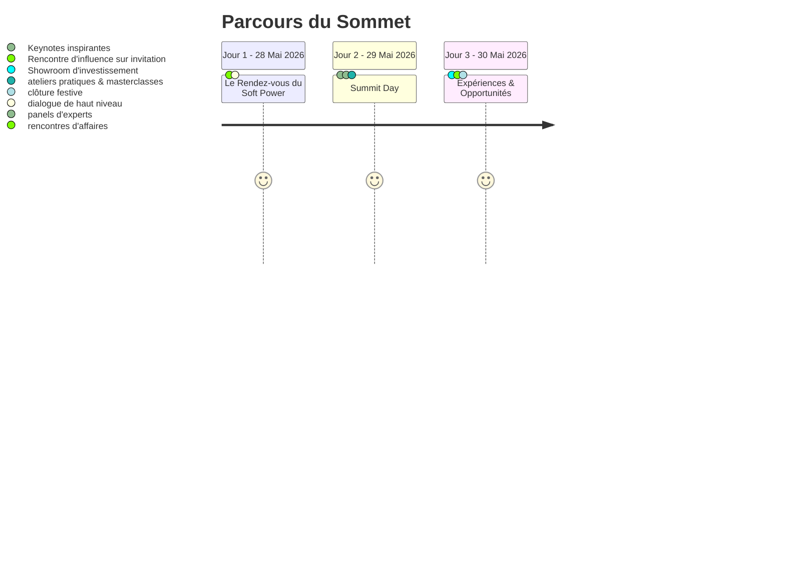

# 🌍 F-Union Africa Summit 2026

<div align="center">


<br />

### *« Transformer la visibilité en opportunités économiques et propulser le leadership féminin africain. »*

**Le carrefour stratégique des femmes leaders, entrepreneures, décideuses institutionnelles et investisseurs pour façonner la vision *Next Africa 2035*.**

[🌐 Site Officiel](https://f-union.org) • [🎟️ Billetterie Officielle](https://billeterie.f-union.org/) • [📰 Espace Presse](https://f-union.org/communique-presse)

---

</div>

## 📖 À Propos du Sommet

Le **F-Union Africa Summit 2026** est une initiative d'envergure panafricaine dédiée à l'accélération du leadership féminin, à la souveraineté économique et à la création de synergies commerciales durables à travers le continent.

Organisé au cœur de la capitale économique du Cameroun, à **Douala**, cet événement réunit pendant trois jours des dirigeantes de premier plan, des fondatrices d'entreprises à fort impact, des personnalités politiques et des acteurs du capital-investissement.

Loin des colloques théoriques, le sommet a été pensé comme un **catalyseur de croissance opérationnelle**, alliant diplomatie d'influence (*Soft Power*), montée en compétences concrète, mentorat stratégique et accès direct aux capitaux.

---

## 🎯 Les 4 Piliers Stratégiques

La mission du F-Union Africa Summit s'articule autour de quatre engagements fondamentaux :

```
┌─────────────────┐     ┌─────────────────┐     ┌─────────────────┐     ┌─────────────────┐
│   IDENTIFIER    │ ──► │     FORMER      │ ──► │    CONNECTER    │ ──► │    PROJETER     │
│  Mettre en      │     │  Masterclasses  │     │   Networking    │     │  Vision Next    │
│  lumière les    │     │  & coaching     │     │   stratégique   │     │  Africa 2035    │
│  talents clés   │     │  sur-mesure     │     │   B2B & Deals   │     │  & Croissance   │
└─────────────────┘     └─────────────────┘     └─────────────────┘     └─────────────────┘
```

1. **Identifier** : Détecter et valoriser les femmes entrepreneures, dirigeantes et innovatrices qui transforment l’écosystème africain.
2. **Former** : Doter les participantes d’outils pratiques immédiatement exploitables (gouvernance juridique, conformité, gestion agile, intelligence financière et expérience client).
3. **Connecter** : Créer des ponts solides entre les porteurs de projets, les multinationales et les institutions financières régionales et internationales.
4. **Projeter** : Inscrire les initiatives féminines dans la trajectoire de transformation économique globale du continent (*Next Africa 2035*).

---

## 📊 Le Sommet en Chiffres

<div align="center">

| Chiffre Clé | Indicateur | Impact & Portée |
| :---: | :--- | :--- |
| **400+** | **Participantes & Délégués** | Dirigeantes, fondatrices de PME, cadres exécutives et décideuses publiques |
| **30+** | **Intervenant(e)s d'Élite** | Experts juridiques, directeurs généraux, experts RH et personnalités publiques |
| **3** | **Journées Immersives** | Du dialogue d'influence restreint à la grande foire d'opportunités |
| **1** | **Écosystème Stratégique** | Une alliance panafricaine concrète au service de la souveraineté économique |

</div>

---

## 🌟 Pourquoi Participer ?

- **🤝 Accéder à un réseau d'influence direct** : Rencontrez plus de 400 actrices et acteurs décisionnels qui façonnent l'économie du continent.
- **📈 Monter en compétences concrètement** : Participez à des ateliers business, des sessions de mentorat 1:1 et bénéficiez de diagnostics personnalisés.
- **📢 Développer votre visibilité et votre marque** : Prenez la parole dans les espaces médias dédiés, pitchez devant des investisseurs et affirmez votre leadership.
- **🌍 Être actrice du changement continental** : Participez à la construction d'une feuille de route collective pour l'autonomisation et le rayonnement de l'Afrique.

---

## 🗓️ Architecture du Programme (3 Jours)



### 🔹 Jour 1 (28 Mai 2026) : *Le Rendez-vous du Soft Power*
> **Format** : Session exclusive *(sur invitation)* réunissant un cercle restreint de décideuses, personnalités diplomatiques et chefs d'entreprises.  
> **Objectif** : Plaidoyer stratégique, leadership d'influence et positionnement des femmes aux tables de négociation institutionnelles.

### 🔹 Jour 2 (29 Mai 2026) : *Summit Day*
> **Format** : Grande journée plénière ouverte aux congressistes.  
> **Contenu** :
> - Conférences magistrales et débats d'actualité économique.
> - Panels thématiques : Transformation digitale bancaire, conformité & droit OHADA, RSE, excellence opérationnelle et retail.
> - Ateliers interactifs de formation au management agile et développement commercial.

### 🔹 Jour 3 (30 Mai 2026) : *Expériences & Opportunités*
> **Format** : Journée orientée business, partenariats et passage à l'échelle.  
> **Contenu** :
> - Espaces de networking qualifié et rencontres B2B.
> - Showroom d'investissement et sessions de pitch projets.
> - Cérémonie de clôture et célébration des réussites féminines.

---

## 🏢 Espaces & Dispositifs Innovants

- **🩺 The Clinic** : Un centre d'orientation et de consultation individuelle où des experts accompagnent les entrepreneures sur leurs problématiques juridiques, financières, fiscales, RH et organisationnelles.
- **🎥 Studio Pro 360** : Un espace audiovisuel dédié au personal branding, avec séances de shooting photo professionnel et interviews pour amplifier l'image publique des participantes.
- **💼 Power Hub & Investment Showroom** : Une arène dédiée à la rencontre entre projets à fort potentiel de croissance et fonds d'investissement, business angels et banques partenaires.
- **🛍️ Pavillon Exposants & Marketplace** : Vitrine commerciale mettant à l'honneur les produits et services innovants *Made in Africa*.

---

## 👥 Intervenant(e)s & Personnalités Réunies

Le sommet réunit un collège pluridisciplinaire d'experts et de leaders d'opinion :

- **Droit des Affaires & Gouvernance** :
  - **Me Aurélie Chazai** — Avocate aux Barreaux de Paris et du Cameroun, Managing Partner de *Chazai Wamba*.
  - **Me Gaëlle Ngue** — Avocate aux Barreaux du Cameroun et du Québec, Associée gérante de *Ngue & Associés*.
- **Banque, Assurance & Finance Digitale** :
  - **Laetissia Enonga-Dissake** — Directrice Centrale Commerciale & Marketing chez *Afri Insurance & Afrilife Insurance*.
  - **Christian Tchoupe** — Account Manager chez *SBS Software*, spécialiste de la transformation digitale bancaire.
  - **Anabelle Koung** — Deputy Manager Corporate & Innovation chez *SanlamAllianz Cameroun*.
- **Capital Humain, Leadership & Prise de Parole** :
  - **Linda** — Fondatrice de *2LN Expertise*, ancienne Directrice du Capital Humain (*MTN, Groupe Activa*).
  - **Honoré Nkouel** — Directeur des Ressources Humaines Afrique Centrale chez *CFAO Infrastructure*.
  - **Jocelyne Ngassam** — Experte en Management Agile et Développement Commercial International.
  - **Thierry Ntamack** — Réalisateur, acteur et coach en prise de parole scénique pour dirigeants.
- **Excellence Opérationnelle, RSE & Santé** :
  - **Laure Krans Nana** — CEO de *QualityPro Consulting*, experte qualité et conformité.
  - **Erika Wilson** — Experte RSE certifiée AFNOR / EDHEC Business School.
  - **Dr. Pechens Pokossy Doumbe** — Docteure en pharmacie, fondatrice de la *Pharmacie du Centre*.
  - **Edithe Nken Hot** — Directrice Générale de *Univers Internes*, consultante en croissance commerciale.
  - **Sandra Gagneur** — Experte Retail Premium & Expérience Client (*ex-Sephora, Zara*).
  - **Prisca Heuya** — Fondatrice de *Kem Care*, valorisation des matières premières locales.

---

## 🎟️ Formules d'Accès & Participations

Plusieurs formules de pass ont été élaborées pour s'adapter aux différents profils :

- **Pass Visiteur / Découverte** : Accès aux espaces d'exposition et aux sessions plénières grand public.
- **Pass Conférence & Masterclass** : Accès complet aux panels thématiques, ateliers de formation et supports exclusifs.
- **Pass VIP & Expérience Premium** : Accès prioritaire, cocktail de réseautage, session dédiée *The Clinic* et services du *Studio Pro 360*.
- **Pass Entreprises & Délégations** : Formules sur-mesure pour les organisations accompagnant leurs collaboratrices et partenaires.

---

## 🤝 Partenaires & Soutiens

Le sommet s'appuie sur la collaboration de groupes industriels, institutions financières, médias panafricains et réseaux d'entrepreneuriat engagés pour l'essor du leadership africain.

---

## 📬 Contact & Informations Utiles

- **Lieu** : Douala, Cameroun
- **Dates** : 28, 29 et 30 Mai 2026
- **Billetterie en ligne** : [billeterie.f-union.org](https://billeterie.f-union.org/)
- **Site web officiel** : [f-union.org](https://f-union.org)
- **E-mail de contact** : contact@f-union.org

---

<div align="center">
  <sub>© 2026 F-Union Africa Summit. Tous droits réservés. Engagés pour l'avenir et l'autonomie économique du continent africain.</sub>
</div>
